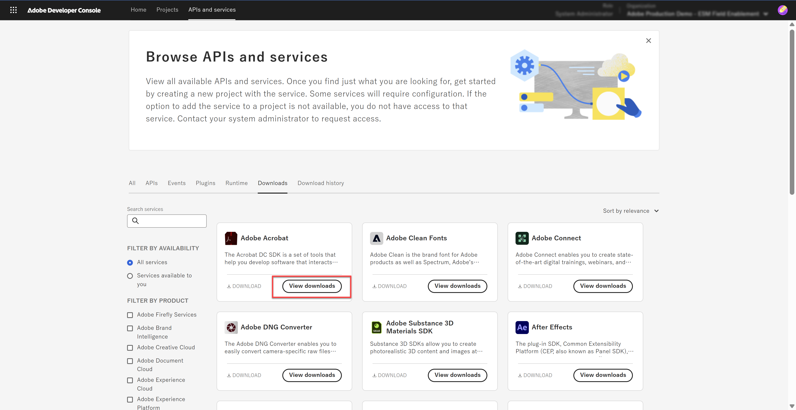

# acrobat-sdk-sample
## Description
Adobe Acrobat のプラグインを **CMake** でビルドするサンプルです。Xcode / Visual Studio のサンプルプロジェクトを使わず、1つの `CMakeLists.txt` から Windows と macOS の両方の成果物を作れるようにします。

SDK のヘッダは、別リポジトリ [acrobat-sdk-cmake](https://github.com/bandetech/acrobat-sdk-cmake) が提供する `Acrobat_SDK` ターゲットから受け取ります。

## Requirements

このサンプルでは、Acrobat SDK内のBasicPluginを使用します。プラグインの実装である `src/BasicPlugin.cpp` と `src/BasicPluginInit.cpp` はAdobe Acrobat SDK に含まれるサンプル BasicPlugin のソースです。再配布できないため、このリポジトリには含めていません。

利用するには、各自が Adobe から SDK を入手してコピーしてください（手順は後述）。`.gitignore` でこれらのファイルを無視しているので、通常のgit addの対象から除外されます。

このリポジトリが提供するのは、**ビルド設定そのもの**（`CMakeLists.txt` と `Info.plist.in`）です。

### 1. このリポジトリをクローンする

```bash
git clone https://github.com/bandetech/acrobat-sdk-sample.git
cd acrobat-sdk-sample
```

以降の手順は、このリポジトリのルートディレクトリで実行します。

### 2. Acrobat SDK を入手する

Adobe の Developer サイトの[Developer Console](https://developer.adobe.com/console)から Acrobat SDK を入手します。


### 3. プラグインのソースをコピーする

ダウンロードしたAcrobat SDKを展開して、その中の`Acrobat_DC_SDK_Windows_2021_v3/Adobe/Acrobat DC SDK/Version 1/PluginSupport/Samples/BasicPlugin/sources` 内の2ファイルを `src/` にコピーします。

```text
acrobat-sdk-sample/
├── CMakeLists.txt
├── Info.plist.in
└── src/
    ├── BasicPlugin.cpp      ← SDK の BasicPlugin/sources サンプルからコピー
    └── BasicPluginInit.cpp  ← 同上
```

### 4. SDK パッケージを用意する

#### 方法 A: ローカルのクローンを `add_subdirectory` で取り込む（現在の設定）

[acrobat-sdk-cmake](https://github.com/bandetech/acrobat-sdk-cmake) をクローンし、その `Headers/API` と `Headers/SDK` に SDK のヘッダを配置します。手順は同リポジトリの README を参照してください。

配置できたら、そのディレクトリを `ACROBAT_SDK_DIR` で指定します。

```bash
cmake -B build -DACROBAT_SDK_DIR=/path/to/acrobat-sdk-cmake
```

#### 方法 B: 準備済みのローカルリポジトリを `FetchContent` で取り込む

別の場所にSDK のヘッダを配置済みのacrobat-sdk-cmakeがある場合には、`FetchContent` を使って取り込むこともできます。

現在の `CMakeLists.txt` は `add_subdirectory` を使っているため、次の行を置き換えます。

```cmake
add_subdirectory("${ACROBAT_SDK_DIR}" acrobat-sdk-cmake EXCLUDE_FROM_ALL)
```

置き換え後:

```cmake
include(FetchContent)
FetchContent_Declare(acrobat_sdk_cmake
    SOURCE_DIR "${ACROBAT_SDK_DIR}"
)
FetchContent_MakeAvailable(acrobat_sdk_cmake)
```

## Build
### Windows（コマンドライン）

```bat
cmake -B build -DACROBAT_SDK_DIR=C:/path/to/acrobat-sdk-cmake
cmake --build build --config Release
```

### macOS（コマンドライン）

```bash
cmake -B build -DACROBAT_SDK_DIR=/path/to/acrobat-sdk-cmake
cmake --build build
# → build/MyCustomPlugin.acroplugin
```

### macOS（Xcode プロジェクトを生成する）

```bash
cmake -B build-xcode -G Xcode -DACROBAT_SDK_DIR=/path/to/acrobat-sdk-cmake
cmake --build build-xcode --config Release
# → build-xcode/Release/MyCustomPlugin.acroplugin
```

`xcode-select` が Command Line Tools を指していると、`-G Xcode` の configure が次のエラーで失敗します。

```text
xcode-select: error: tool 'xcodebuild' requires Xcode, but active developer directory
'/Library/Developer/CommandLineTools' is a command line tools instance
```

そのコマンドの間だけ Xcode を使う場合、

```bash
DEVELOPER_DIR=/Applications/Xcode.app/Contents/Developer \
  cmake -B build-xcode -G Xcode -DACROBAT_SDK_DIR=/path/to/acrobat-sdk-cmake
```

現在の向き先は `xcode-select -p` で確認できます。


## 関連記事

- [Acrobatプラグイン開発のCMake化 Windows編](https://qiita.com/azblueground/items/0064a04c320b22d91316)
